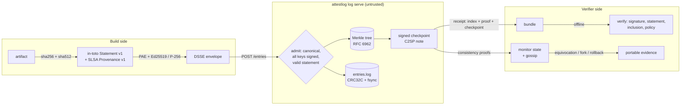

# attestlog

[](https://github.com/rishabhl3116-a11y/attestlog/actions/workflows/ci.yml)

**SLSA provenance and in-toto attestations, with an offline transparency log that you do not have to trust.**

attestlog is a single Go binary with no third-party dependencies. It does four things:

- **Attests.** It hashes a build artifact and writes an in-toto Statement v1 carrying a SLSA Provenance v1 predicate. It then signs the statement as a DSSE envelope with Ed25519 or ECDSA P-256 (multi-signature supported).
- **Verifies.** It checks the envelope against a deny-by-default policy: trusted keys and threshold, allowed builder IDs, buildType, source repo, ref and pinned commit, and artifact digest. Every rule is reported by name.
- **Logs.** It appends envelopes to an append-only RFC 6962/9162 Merkle tree served over HTTP. Each append produces a signed checkpoint (a C2SP signed note).
- **Audits.** Clients verify inclusion and consistency proofs themselves, and they detect equivocation, forks and rollbacks. Detection produces portable evidence that anyone with the log key can check offline.

It implements the core mechanics behind Sigstore's Rekor and the Go checksum
database in a codebase small enough to read in an afternoon, and tests them
against public reference vectors. It is **not** a
production service (see [Limitations](#limitations) and the
[comparison with Sigstore/Rekor](#how-this-compares-to-sigstore--rekor)).

**Good for:**

- Engineers learning how supply-chain attestations and transparency logs actually work.
- Teams prototyping provenance policies offline.
- Anyone who wants a readable reference for RFC 9162 proofs and C2SP checkpoints.

## Why

A signed build attestation only helps if you can check it against a policy, and a transparency log only helps if clients do not have to trust the operator. attestlog puts both halves in one small tool: attestations are verified deny-by-default, and every log response is verified by the client with Merkle proofs, so a log that rewrites history or shows different clients different views gets caught.

## Architecture



The full design, algorithms and complexity analysis are in
[docs/ARCHITECTURE.md](docs/ARCHITECTURE.md). The threat model is in
[docs/THREAT_MODEL.md](docs/THREAT_MODEL.md).

| Package | Responsibility |
|---|---|
| `pkg/keys` | Ed25519 / ECDSA P-256 signers, PKCS#8/PKIX PEM, SHA-256 key IDs |
| `pkg/dsse` | DSSE v1 PAE, envelopes, distinct-key threshold verification |
| `pkg/intoto`, `pkg/slsa` | Statement v1, ResourceDescriptor, Provenance v1, source extraction |
| `pkg/policy`, `pkg/verify` | deny-by-default rules and the authenticate-then-evaluate pipeline |
| `pkg/merkle` | RFC 6962 hashing, stored-subtree tree, PATH/PROOF generation, RFC 9162 verification |
| `pkg/note`, `pkg/checkpoint` | C2SP signed notes (byte-compatible with Go's `sumdb/note`) and tlog checkpoints |
| `pkg/tlog` | canonical entries, durable store, the log |
| `pkg/server`, `pkg/client`, `pkg/api` | HTTP API and a client that verifies every response |
| `pkg/monitor` | TOFU state, consistency-checked updates, gossip comparison, evidence |
| `pkg/bundle` | offline receipt (envelope, keys, inclusion proof, signed checkpoint) |
| `internal/cli`, `cmd/attestlog` | the `attestlog` command |

## Quick start

Requirements: Go ≥ 1.24. `make check` also needs `golangci-lint` v2.

```sh
make build                       # -> bin/attestlog
make demo                        # full offline walkthrough (below)
make check                       # gofmt + golangci-lint + vet + race tests + coverage gate
```

By hand:

```sh
A=bin/attestlog
$A keygen --alg ed25519 --out release          # release.key (0600), release.pub
$A log keygen --origin log.example.test --out log
$A log serve --data ./logdata --key log.key --addr 127.0.0.1:8088 &

$A attest --artifact app.tar.gz --key release.key \
  --builder-id https://ci.example.test/builders/release@v2 \
  --source-repo git+https://git.example.test/acme/app --source-ref refs/tags/v1.0.0 \
  --source-digest gitCommit:<40-hex commit>

$A log submit --server http://127.0.0.1:8088 --log-key log.vkey \
  --attestation app.tar.gz.intoto.json --pubkey release.pub --out app.bundle.json

$A verify --artifact app.tar.gz --bundle app.bundle.json --pubkey release.pub \
  --policy examples/demo/policy.json --log-key log.vkey      # offline
$A log prove --server http://127.0.0.1:8088 --log-key log.vkey --state monitor.state --bundle app.bundle.json
```

Exit codes: `0` ok, `1` verification failed or error, `2` usage error, `3` the log was caught misbehaving.

A policy looks like this ([examples/demo/policy.json](examples/demo/policy.json)):

```json
{
  "version": 1,
  "allowedBuilderIds": ["https://ci.example.test/builders/release@*"],
  "allowedBuildTypes": ["https://github.com/rishabhl3116-a11y/attestlog/buildtypes/generic/v1"],
  "allowedSourceRepos": ["git+https://git.example.test/acme/hello-cli"],
  "allowedSourceRefs": ["refs/tags/v1.0.0"],
  "requireSourceDigest": true,
  "signatureThreshold": 1,
  "requireTransparencyLog": true
}
```

## Example: the demo walkthrough

`make demo` runs [scripts/demo.sh](scripts/demo.sh) entirely on `127.0.0.1`
with bundled fixtures. The output below is from a real run, trimmed to the
interesting steps. Keys are fresh on every run, so hashes and ports differ
from run to run.

```
== 5. Verify offline: signature, statement, policy and log inclusion (no server contact)
$ attestlog verify --artifact .demo/hello-cli_1.0.0_linux_amd64.txt --bundle .demo/release.bundle.json --pubkey .demo/release.pub --policy examples/demo/policy.json --log-key .demo/log.vkey
verifying .demo/hello-cli_1.0.0_linux_amd64.txt
  [PASS] signature-threshold  1 distinct trusted signer(s), need 1
  [PASS] statement            in-toto Statement v1 with 1 subject(s)
  [PASS] subject-digest       artifact matches subject "hello-cli_1.0.0_linux_amd64.txt"
  [PASS] predicate            SLSA Provenance v1
  [PASS] builder-id           builder "https://ci.example.test/builders/release@v2"
  [PASS] build-type           buildType "https://github.com/rishabhl3116-a11y/attestlog/buildtypes/generic/v1"
  [PASS] source-repo          source "git+https://git.example.test/acme/hello-cli"
  [PASS] source-ref           ref "refs/tags/v1.0.0"
  [PASS] source-digest        source digest gitCommit:3f2a9c1e5b7d4a6f8e0c2b4d6f8a0c2e4b6d8f0a
  [PASS] transparency-log     entry 0 included in demo.log.example.test at tree size 1
verification PASSED

== 6. Attack: the artifact is swapped after the build
...
  [FAIL] subject-digest       artifact sha256:318c968480b323b8… matches no subject
...
attestlog: verification FAILED
(exit 1, as expected)

== 7. Attack: a rogue builder attests and logs the same artifact
...
  [FAIL] builder-id           builder "https://laptop.example.test/manual-build"
  [PASS] build-type           buildType "https://github.com/rishabhl3116-a11y/attestlog/buildtypes/generic/v1"
  [FAIL] source-repo          source "git+https://git.example.test/mallory/hello-cli-fork"
  [FAIL] source-ref           ref "refs/heads/main"
  [FAIL] source-digest        source digest (none: source named only by a mutable ref)
  [PASS] transparency-log     entry 1 included in demo.log.example.test at tree size 2
attestlog: verification FAILED
(exit 1, as expected)
-> the log makes the rogue attestation discoverable:
$ attestlog log search --server http://127.0.0.1:64137 --log-key .demo/log.vkey --artifact .demo/hello-cli_1.0.0_linux_amd64.txt
2 log entries for .demo/hello-cli_1.0.0_linux_amd64.txt: 0, 1

== 8. Monitor: trust on first use, then prove append-only growth
$ attestlog log prove --server http://127.0.0.1:64137 --log-key .demo/log.vkey --state .demo/monitor.state --index 0
checkpoint: origin=demo.log.example.test size=2 root=b02dfb39639009d5b43dd228612646e3b070238fb84fa5ea52e12339452e46ea signed=2026-10-24T17:12:43Z
consistency: no trusted state yet; trusting size 2 (TOFU) -> .demo/monitor.state
inclusion: entry 0 (leaf 86c1c968a80b6193e5ef54d6872ca4f0f2b9cdc59e0fa27cd786da87ac14f775) is in tree 2 — 1-hash proof verified
    [0] c45e59168bff239cca39705a3ac7d3e17fd8f1fb580f0e89d97afba845d21b8e
(logged 3 nightly attestations)
$ attestlog log prove --server http://127.0.0.1:64137 --log-key .demo/log.vkey --state .demo/monitor.state --bundle .demo/release.bundle.json
checkpoint: origin=demo.log.example.test size=5 root=afe8bad0bc0c834cdd88d351a46b46373757942faef1b5af6d2de7e8e78b7fe signed=2026-10-24T17:12:43Z
consistency: size 2 -> 5 verified (append-only); state advanced
inclusion: bundle entry 0 verified offline against its checkpoint (size 1)
consistency: bundle checkpoint (size 1) is a prefix of the current log (size 5)

== 9. Attack: the log operator forks history (same key, rewritten entries) for a second client
forked log listening on http://127.0.0.1:64146
(forked view holds 5 different entries, signed with the same log key)
$ attestlog log prove --server http://127.0.0.1:64146 --log-key .demo/log.vkey --state .demo/monitor.state --evidence-out .demo/fork-evidence.json
checkpoint: origin=demo.log.example.test size=5 root=6c62c12d1dc41cd90e5511e6f534357ae455463f8da6811fa1b4537ad144fa98 signed=2026-10-24T17:12:43Z
evidence written to .demo/fork-evidence.json
attestlog: monitor: log demo.log.example.test misbehaved (equivocation): two signed checkpoints for tree size 5 with roots afe8bad0bc0c834c… and 6c62c12d1dc41cd9…
(exit 3, as expected)

== 10. Anyone holding the log key can check the evidence offline
$ attestlog log evidence --log-key .demo/log.vkey --file .demo/fork-evidence.json
evidence VERIFIED: equivocation by demo.log.example.test
  two signed checkpoints for tree size 5 with roots afe8bad0bc0c834c… and 6c62c12d1dc41cd9…
```

Step 11 shows the same split view caught by gossip: two clients save the
checkpoints they were served and run `attestlog log compare`.

## How it works: design decisions

The full list of decisions, each with its rationale and the cost if it is
wrong, is in [DECISIONS.md](DECISIONS.md). The most important ones:

- **The server is untrusted.** The client rebuilds the canonical entry, hashes it, and verifies the receipt's inclusion proof *before* it writes a bundle. Every later proof is verified too. A tampering-middleware test suite exercises this.
- **Authenticate, then parse.** An envelope with no valid trusted signature produces exactly one failed check (`signature`). Its payload is never decoded into policy input.
- **One leaf per entry.** Entries must be canonical JSON with normalised keys, so deduplication, search and offline bundle reconstruction all agree on the leaf hash.
- **Deny by default.** Empty allowlists and unknown policy fields are rejected. Builder IDs match exactly or as `<id>@*`, never by prefix.
- **Conclusive evidence where possible.** Equivocation (same size, two roots) and rollback (a smaller tree signed later, made possible by the checkpoint timestamp) are self-contained proofs. Failed consistency proofs are reported as weaker evidence, and the docs say so.
- **Formats people know.** DSSE, in-toto v1, SLSA v1, RFC 6962 hashing, and C2SP signed-note/tlog-checkpoint. Note signing matches the Go `sumdb/note` test vector byte for byte.
- **Zero dependencies.** It uses only the Go standard library, so the supply-chain tool's own supply chain is empty.

## Testing

```sh
make check   # gofmt -l, golangci-lint (0 issues), go build + vet, go test -race, coverage gate
```

| What | Evidence | Command |
|---|---|---|
| RFC 6962 hashing | golden leaf, interior-node and root hashes for tree sizes 0 to 8 (transparency-dev reference) | `go test ./pkg/merkle -run TestRFC6962Vectors` |
| Proof verification | 98 inclusion + 98 consistency upstream probes, valid and adversarial, all classified correctly | `go test ./pkg/merkle -run 'Probes' -v` |
| Proof generation | for every tree size up to 70: root equals a recursive-MTH oracle; every inclusion proof and every consistency pair verifies; wrong-index and tampered-root variants are rejected | `go test ./pkg/merkle -run TestPropertyProofsRoundTrip` |
| Signed notes | byte-identical to Go `sumdb/note` vector | `go test ./pkg/note -run TestSumdbNoteVector` |
| Equivocation, fork and rollback | split view via gossip, history rewrite, consistent stale cache vs. later-signed smaller tree, evidence re-verification, bogus-evidence rejection | `go test ./pkg/monitor -v` |
| Lying server | tampered receipt, audit path, leaf hash and proof labels all detected | `go test ./pkg/client -run TestLyingServerDetected` |
| End to end | CLI against a live honest log and a forked log | `go test ./internal/cli -run TestEndToEndCLI` |
| Fuzzing | inclusion verification, DSSE parse+verify, note open, checkpoint parse (seeds run in `make test`) | `make fuzz` |

**Coverage.** Statement coverage of `./pkg/...` across the whole suite was
**95.3%** (`./scripts/coverage.sh`, gate 80%). The CLI package is 87.8%
(`go test -cover ./internal/cli`).

### Benchmarks

Command: `make bench`. Hardware: Apple M1 Pro. The machine was shared with
other builds, so treat these as order-of-magnitude figures.

| Operation | Result |
|---|---|
| Merkle append (amortised) | 196 ns/op, 0 allocs |
| Inclusion proof, 1,048,569-leaf tree (ragged edge) | 2.2 µs/op |
| Consistency proof, same tree | 1.8 µs/op |
| Verify inclusion proof, same tree | 1.7 µs/op |
| Ed25519 sign / verify (1 KiB) | 22 µs / 44 µs |
| ECDSA P-256 sign / verify (1 KiB) | 27 µs / 61 µs |
| Log admission, in-memory store (parse + DSSE verify + append + sign checkpoint) | 89 µs/entry (about 11k entries/s) |
| Log admission, file store with fsync per entry (macOS `F_FULLFSYNC`) | 4.0 ms/entry (about 250 entries/s) |

Durable throughput is limited by one fsync per entry. Batching is on the
roadmap.

## How this compares to Sigstore / Rekor

Sigstore is the production system this project borrows its ideas from.
attestlog is much smaller.

| | attestlog | Sigstore (Rekor + Fulcio + cosign) |
|---|---|---|
| Purpose | readable reference implementation, offline | public-good production infrastructure |
| Signing identity | long-lived keys you distribute yourself | "keyless": short-lived Fulcio certificates bound to OIDC identities, plus long-lived keys |
| Log backend | single process, in-memory tree, one append-only file | Rekor v1 is built on Trillian with a database backend. Newer Rekor versions move to a tile-based design (check current Sigstore docs) |
| Entry types | DSSE envelopes carrying in-toto statements | many types (hashedrekord, DSSE, intoto, and others) |
| Inclusion receipt | inclusion proof + signed checkpoint returned synchronously | inclusion proofs + checkpoints. Rekor v1 also issues a Signed Entry Timestamp (an inclusion *promise*) |
| Checkpoint format | C2SP signed note | also signed-note style checkpoints |
| Witnessing / gossip | local state, `log compare` between two files | ecosystem work on independent witnesses and monitors |
| Scale and availability | small scale. The whole tree stays in memory (about 64 MB per million entries). No replication, auth or rate limiting | operated, replicated, sharded over time |
| Policy | built-in SLSA builder/source/digest policy | done by separate tools (for example slsa-verifier, policy-controller) |

Use Sigstore for anything real. attestlog is useful for understanding and
testing the mechanisms: every proof, signature and policy decision lives in a
few hundred lines that you can step through.

## Project layout

```
cmd/attestlog/     entry point
internal/cli/      subcommands (keygen, attest, verify, log ...)
pkg/               library packages (see the table above)
examples/demo/     demo artifact and policy
scripts/           demo.sh, coverage.sh
docs/              ARCHITECTURE.md, THREAT_MODEL.md
DECISIONS.md       design decisions with rationale
```

## Limitations

- **Not production software.** It has no authentication, rate limiting,
  replication or backups, and it has not had a security audit.
- **Small scale.** The tree and the entry bodies live in memory after replay.
  Memory grows linearly with the log.
- **Durability costs throughput.** There is one fsync per entry and no group
  commit.
- **No identity layer.** It has no keyless signing, certificates, key
  revocation or key rotation. Trusted keys and the log key are distributed
  out of band.
- **Detection, not prevention, of log misbehaviour.** It relies on TOFU and
  on clients actually comparing checkpoints. A split view that nobody gossips
  about goes unnoticed. Inconsistency evidence (as opposed to equivocation or
  rollback evidence) needs the third party to re-query the log.
- **Timestamps are the log's claim**, not trusted time.
- **The provenance convention is attestlog's own.** Source extraction
  understands `externalParameters.source` and `git+` resolved dependencies.
  Provenance from other builders with different layouts fails closed with
  "no source" rather than being interpreted.
- **No real-world interop testing.** Formats follow the specs, and note
  signing is checked against Go's vector. Envelopes and bundles from cosign
  or slsa-github-generator have not been tested, and the bundle format is
  attestlog's own, not the Sigstore bundle.

## Roadmap

- Batched sequencing (group commit) and an on-disk or tiled node store
  (tlog-tiles) for large logs.
- Witness cosigning: independent witnesses add their signatures to
  checkpoints (C2SP tlog-witness).
- Read and verify Sigstore bundles and slsa-github-generator provenance.
- Key rotation for the log and the builders, with revocation lists in
  policy.
- Optional ECDSA log keys in signed notes.

## License

MIT, see [LICENSE](LICENSE). The test vectors in `pkg/merkle/testdata` are
Apache-2.0; see [DATA.md](DATA.md).

## Maintainer

Originally developed under the `rishabhl3116-a11y` project account; currently
maintained by Rishabh Sharma.

For project questions or collaboration: [Rishabhl3116@gmail.com](mailto:Rishabhl3116@gmail.com) · [LinkedIn](https://linkedin.com/in/rishabh-sharma-8b2396168).