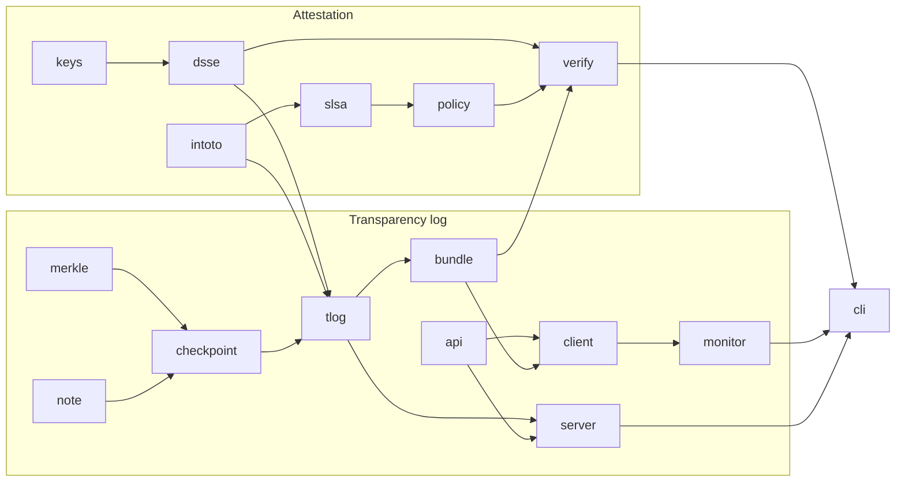

# attestlog architecture

attestlog has two halves that share one data model:

1. **Attestation**: build an in-toto Statement v1 carrying a SLSA Provenance
   v1 predicate, sign it as a DSSE envelope, and later verify it against a
   policy.
2. **Transparency**: append envelopes to an RFC 6962/9162 Merkle-tree log,
   publish signed checkpoints, and let clients verify inclusion,
   consistency, and absence of equivocation without trusting the server.

## Module map

```
cmd/attestlog          process entry point (signals -> context)
internal/cli           flag parsing, commands, exit codes
internal/testutil      signed fixtures shared by tests

pkg/keys        Ed25519 / ECDSA P-256 signers, PEM I/O, key IDs
pkg/dsse        PAE, envelopes, threshold verification
pkg/intoto      Statement v1, ResourceDescriptor, DigestSet matching
pkg/slsa        Provenance v1 predicate, source extraction
pkg/policy      deny-by-default rules -> named checks
pkg/verify      authentication -> statement -> receipt -> policy pipeline

pkg/merkle      RFC 6962 hashing, stored-subtree tree, proofs (gen + verify)
pkg/note        C2SP signed notes (Ed25519), sumdb-compatible
pkg/checkpoint  C2SP tlog-checkpoint body + signing/opening
pkg/tlog        entry canonicalisation, durable store, the Log
pkg/api         HTTP wire types
pkg/server      HTTP front end (untrusted)
pkg/client      verifying client
pkg/monitor     trusted state, consistency-checked updates, evidence
pkg/bundle      offline receipt: envelope + keys + proof + checkpoint
```

Dependency direction runs strictly downward. `merkle`, `note`, `keys` and
`intoto` have no project dependencies. Nothing in `pkg/` imports `internal/`.



## Attestation format

```
DSSE envelope {payloadType: "application/vnd.in-toto+json", payload: b64(Statement), signatures[]}
  Statement {_type: "https://in-toto.io/Statement/v1",
             subject: [{name, digest: {sha256, sha512}}],
             predicateType: "https://slsa.dev/provenance/v1",
             predicate: Provenance}
    Provenance.buildDefinition {buildType, externalParameters{source{uri,ref,digest}, ...}, resolvedDependencies[]}
    Provenance.runDetails      {builder{id}, metadata{invocationId, startedOn, finishedOn}}
```

Signatures cover `PAE(payloadType, payload)`:

```
"DSSEv1" SP len(type) SP type SP len(body) SP body
```

PAE binds the payload type. An envelope re-labelled as `application/json`
fails verification (tested in `TestTamperingDetected`).

### Verification pipeline (`pkg/verify`)

| Step | Rule | On failure |
|---|---|---|
| 1 | At least one signature from a trusted key verifies over PAE | Stop. Only the `signature` check is reported, and the payload is **never parsed** |
| 2 | `payloadType` is in-toto | Stop |
| 3 | Statement parses: `_type`, ≥1 subject, valid digests, predicateType | Stop |
| 4 | Bundle receipt (if any): checkpoint signature, proof size and index, inclusion | Recorded as `transparency-log` failure |
| 5 | Policy: threshold, subject digest, predicate, builder, buildType, repo, ref, source digest, log | Every rule runs, and all failures are reported |

Digest matching (`DigestSet.Matches`) requires at least one shared algorithm
and fails if any shared algorithm disagrees. So `{sha256: A, sha512: X}`
does not match `{sha256: A, sha512: Y}`.

## Merkle tree (`pkg/merkle`)

Hashing follows RFC 9162 §2.1.1: `leaf = SHA-256(0x00‖d)`,
`node = SHA-256(0x01‖l‖r)`, empty tree = `SHA-256("")`.

### Storage: complete-subtree levels

`levels[h][i]` holds the hash of the perfect subtree of height `h` covering
leaves `[i·2^h, (i+1)·2^h)`. Appending pushes the leaf to level 0. While a
level has an even count, the last two entries are hashed into the next level.

```
size 6:  level2: [H(0..3)]
         level1: [H(0,1) H(2,3) H(4,5)]
         level0: [l0 l1 l2 l3 l4 l5]
```

The RFC recursion `MTH(D[lo:hi])` splits at `k` = the largest power of two
below `n`. The left half `D[lo:lo+k]` is always a perfect, aligned subtree,
so it is a single array lookup. Only the ragged right edge recurses.

| Operation | Hashes computed | Space |
|---|---|---|
| Append | amortised O(1), worst O(log n) | total < 2n stored hashes |
| Root at size m | O(log² m) worst (ragged edges), O(1) for a power of two | O(log m) stack |
| Inclusion proof PATH(m, D[n]) | O(log² n) worst | O(log n) |
| Consistency proof PROOF(m, D[n]) | O(log² n) worst | O(log n) |
| Verify inclusion / consistency | O(log n) | O(1) extra |

Measured on a 2^20-7 leaf tree, which is the ragged worst case: about 2.2 µs
per inclusion proof and 1.8 µs per consistency proof (`make bench`, numbers
in the README).

### Verification algorithms

Both verifiers transcribe RFC 9162 directly.

**Inclusion (§2.1.3.2).** `fn = index`, `sn = size-1`, `r = leaf`. For each
proof element `p`: if `sn = 0`, fail (proof too long). If `fn` is odd or
`fn = sn`, set `r = H(p‖r)` and, while `fn` is even and non-zero, shift `fn`
and `sn` right. Otherwise set `r = H(r‖p)`. Then shift both right once. At
the end, `sn` must be 0 (else the proof is too short) and `r` must equal the
root.

**Consistency (§2.1.4.2).** If `size1` is a power of two, prepend `root1`.
Strip trailing 1-bits of `fn = size1-1` (shifting `sn = size2-1` with it),
then fold the path into two accumulators `fr` and `sr`. `fr` only absorbs
left siblings and `sr` absorbs both sides. At the end, `fr = root1`,
`sr = root2` and `sn = 0` must all hold.

Edge cases are pinned by the 196 upstream probes: an index at or beyond the
size, empty proofs, proofs with trailing or preceding garbage, swapped roots,
bit flips at every position, and `size1 = 0`. Consistency from an empty tree
is rejected, as RFC 9162 defines it only for `0 < m`.

Correctness evidence:

1. RFC 6962 golden roots and interior nodes for sizes 0 to 8.
2. 98 inclusion and 98 consistency upstream probes.
3. A property test that, for every size up to 70, checks the stored-level
   root against a literal recursive MTH oracle. It also verifies every
   inclusion proof and every consistency pair `(s1, s2)`, and rejects
   wrong-index and tampered-root variants.
4. A fuzz target that mutates valid proofs and requires rejection.

## Log entries (`pkg/tlog`)

```json
{"apiVersion":"attestlog/v1","kind":"dsse",
 "spec":{"envelope":{...},"publicKeys":["-----BEGIN PUBLIC KEY-----..."]}}
```

- **Canonical form.** The body must equal Go's `json.Marshal` of the parsed
  struct, and public keys are PKIX PEM, sorted by key ID and de-duplicated.
  `ParseEntry` rejects any other byte string, so each logical entry has
  exactly one leaf hash.
- **Admission.** The entry must be canonical. Every listed key must have
  signed. The payload type must be in-toto, and the statement must be valid.
- **Deduplication.** A map from leaf hash to index returns the existing
  receipt (HTTP 200 instead of 201).
- **Index.** `alg:value` of every subject digest maps to the entry indices
  (`GET /entries?subject=`).

### Durable store

```
entries.log := record*
record      := u32be(len) ‖ body ‖ u32be(crc32c(body))
```

`Append` writes the record and fsyncs before the log signs a new checkpoint.
If the write fails, is short, or the fsync fails, `Append` truncates the file
back to the offset where the record started and fsyncs that truncation, then
returns the error; the log does not touch its in-memory tree, so nothing is
acknowledged or signed. Without this, the next append would land after the
leftover bytes: a torn leftover breaks the following record's CRC on replay,
and a complete leftover replays as an extra leaf that disagrees with
checkpoints already signed. If the rollback itself fails, the store latches
and every later `Append` returns `ErrStoreFailed`; a restart replays the file
and truncates the torn tail. Tests inject these faults through a wrapper over
the store's file (`export_test.go`).

`Load` replays records:

- A short final record is a torn write that was never acknowledged, so it is
  truncated and logged at WARN.
- A complete record with a bad CRC is `ErrCorruptStore`. Silently dropping a
  record that may already be covered by a signed checkpoint would fork the
  log.

### Concurrency

`Log` uses one `sync.RWMutex`. `Add` takes the write lock across the
duplicate check, the store append, the tree append and checkpoint signing,
so the signed head always matches the durable state. Proofs, entries,
search and head reads take the read lock. Signature verification of the
submitted envelope happens before the lock is taken. The race detector runs
the tests (`make race`), including a concurrent add-and-prove test.

## Checkpoints (`pkg/note`, `pkg/checkpoint`)

Real checkpoint from a `make demo` run (`.demo/alice.checkpoint`):

```
demo.log.example.test
5
r+i60LwMg0zdiNNRpGtGNzdXlC+u8bWvbS3n6OeLf+I=
timestamp 1792861963557

— demo.log.example.test GTPta0dnY29zCWhA0l3C7bxwPPIBFw4EWJhNMkyco0W6RK3lexjXnz+r+tNhWGU5RhJ1L8falEF+6V+/QjCBMQ8AHgA=
```

The lines are, in order: the origin (equal to the note key name), the tree
size, the base64 root hash, and the `timestamp` extension (signing time in
Unix milliseconds). After the blank line comes the signature line,
`— <name> base64(keyhash[4] ‖ ed25519 sig[64])`.

Key hash = `SHA-256(name ‖ "\n" ‖ 0x01 ‖ pubkey)[:4]`. `checkpoint.Open`
requires the origin line to equal the verifier's key name, which binds the
head to the log identity. Signing output is byte-identical to
`golang.org/x/mod/sumdb/note`; the test reproduces the upstream vector.

## HTTP API (`pkg/server`, `pkg/api`)

| Method & path | Response |
|---|---|
| `POST /api/v1/log/entries` `{envelope, publicKeys[]}` | 201, or 200 for a duplicate: `{logIndex, leafHash, duplicate, checkpoint, inclusionProof}` |
| `GET /api/v1/log/entries/{index}` | `{logIndex, leafHash, body(b64)}` |
| `GET /api/v1/log/entries?subject=alg:hex` | `{logIndices[]}` |
| `GET /api/v1/log/checkpoint` | signed note, `text/plain` |
| `GET /api/v1/log/proof/inclusion?index=&treeSize=` or `?leafHash=&treeSize=` | `{logIndex, treeSize, hashes[]}` |
| `GET /api/v1/log/proof/consistency?from=&to=` | `{from, to, hashes[]}` |
| `GET /api/v1/log/publickey` | verifier key string |
| `GET /healthz` | `{status, treeSize}` |

Hardening:

- Request bodies are capped at 2 MiB and client reads at 4 MiB.
- The server sets read-header, read, write and idle timeouts, and caps
  headers at 16 KiB.
- Panics are recovered, and every request gets a structured access log
  (slog).
- Error mapping: 400 for bad input, 404 for an unknown index or leaf, 413 for
  an oversized body, 500 for anything else.

## Client verification (`pkg/client`)

Each server response is checked before use:

| Response | Client check |
|---|---|
| checkpoint | note signature under the pinned key, and origin = key name |
| submit receipt | rebuild the canonical entry locally, hash it, and verify the inclusion proof against the returned checkpoint *before* writing the bundle |
| entry | `H(0x00‖body)` = claimed leaf hash, index matches, body is canonical |
| proofs | echoed index, size and range match the request, and every hash is exactly 32 bytes |

Any mismatch returns `ErrMisbehaviour`, and the CLI exits with code 3.

## Monitoring and misbehaviour (`pkg/monitor`)

`Compare(a, b)` checks two verified checkpoints of one origin:

| Situation | Result |
|---|---|
| same size, same root | ok |
| same size, different root | **equivocation** (conclusive: two signatures) |
| smaller tree signed strictly later | **rollback** (conclusive: logs never shrink) |
| smaller size is 0 | ok iff root = SHA-256("") |
| otherwise | fetch PROOF(small, large); failure gives **inconsistent** |

`Update(state, source)` is the monitor loop:

1. Load the trusted head. If there is none, use TOFU and save the current
   head.
2. Fetch the current head and `Compare` the two.
3. On a `ForkError`, return the evidence and leave the state unchanged.
4. If the current head is older, return `Stale`. `StaleVerified` tells
   whether the source could also prove the old head consistent.
5. Otherwise save the new head. The state file is replaced atomically
   (temp file, fsync, rename).

`VerifyEvidence` lets a third party re-check evidence with only the log's
public key.

## Bundle (`pkg/bundle`)

```json
{"mediaType":"application/vnd.attestlog.bundle+json;version=0.1",
 "envelope":{...}, "publicKeys":[...],
 "log":{"logIndex":0,"checkpoint":"<signed note>","inclusionProof":{"logIndex":0,"treeSize":1,"hashes":[]}}}
```

Offline verification rebuilds the canonical entry from `envelope` and
`publicKeys`, hashes it, and checks the proof against the signed checkpoint.
The log is never contacted. `log prove --bundle` adds online freshness: it
checks that the bundle's checkpoint is a prefix of the log's current head.
